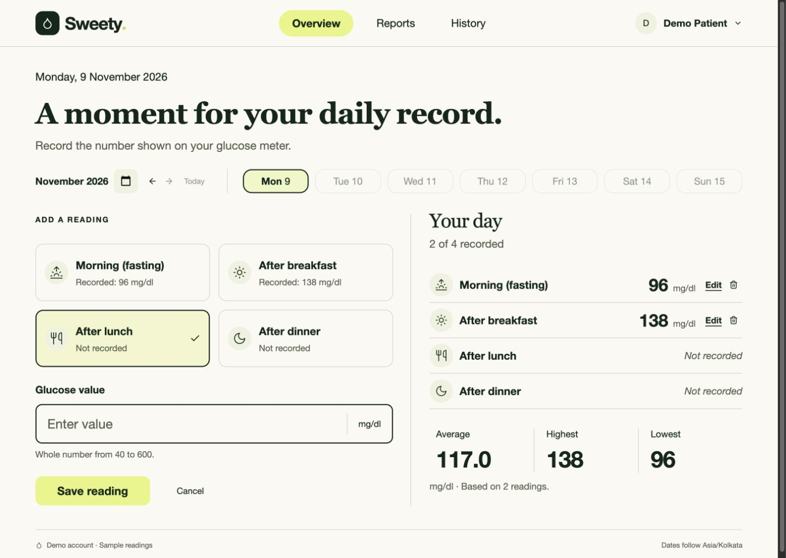

# Sweety

A blood glucose tracker built with React, Node.js, Express and PostgreSQL. Patients can record four daily slots and retrieve daily, month-to-date and previous-month reports.

**Current status:** React frontend and API implemented, integrated and tested. Desktop/mobile screenshots are included below. Local production preview is verified; no hosted deployment is claimed. This is an assignment prototype, not a clinical decision tool.



[Reports](docs/screenshots/submission/06-reports.jpg) · [Monthly chart](docs/screenshots/submission/07-chart-data.jpg) · [Mobile overview](docs/screenshots/submission/11-overview-mobile.jpg) · [Login](docs/screenshots/submission/01-login.jpg)

**For reviewers:** [Submission checklist and walkthrough](SUBMISSION.md) · [Screenshot gallery](docs/screenshots/submission/README.md) · [Test report](TEST_REPORT.md) · [CI](https://github.com/MayankAtri/Sweety/actions)

## Requirements

- Full-stack Docker: Docker Engine/Desktop with Compose v2; no host Node/PostgreSQL needed.
- Local development/tests: Node.js 22 or newer, npm, PostgreSQL 17+ and Redis 7+ (native or Docker).

## Quick start: full-stack Docker

```sh
git clone https://github.com/MayankAtri/Sweety.git
cd Sweety
docker compose up -d --build --wait
docker compose exec api node server/scripts/seed.js
```

Open **http://localhost:8080** and use the demo account below, or register your own account. The API runs migrations automatically before listening. Compose runs PostgreSQL, Redis, the API, a BullMQ worker and nginx; nginx serves the optimized React build and proxies `/api` internally. The API has no host-exposed port. A root `.env` is not required for this path; optional `APP_TIMEZONE` overrides the default Asia/Kolkata.

```sh
docker compose ps                    # db/redis/api/web healthy; worker running
docker compose logs -f api           # API logs
docker compose down                 # stop; preserve named database volume
docker compose up -d --wait          # restart with stored accounts/readings
```

This is a **local HTTP** setup: API `NODE_ENV=development` intentionally keeps cookies usable over HTTP; React assets are still built in production mode. Database credentials in Compose are development examples. Production requires HTTPS, secure cookie mode, proper secrets and proxy configuration. Do not run `down -v` unless you intend to erase the database volume. Local and Docker stacks both use a host-only session cookie on `localhost`; use one stack at a time or separate browser profiles to avoid cookie collisions between their separate databases.

## Local development: install and configure

```sh
git clone https://github.com/MayankAtri/Sweety.git
cd Sweety
npm ci
cp .env.example .env
```

The API and scripts load `.env` from the repository root, regardless of working directory. Existing environment variables take precedence.

| Variable | Purpose / default |
| --- | --- |
| `DATABASE_URL` | Required PostgreSQL connection string for the app/migrations/seed |
| `TEST_DATABASE_URL` | Dedicated disposable database ending in `_test`; required for tests |
| `NODE_ENV` | `development`, `test`, or `production`; default `development` |
| `PORT` | API port; default `3001` |
| `CLIENT_ORIGIN` | Exact permitted browser origin, no trailing slash; default `http://localhost:5173` |
| `APP_TIMEZONE` | IANA time zone used to determine today; default `Asia/Kolkata` |
| `REDIS_URL` | Optional API cache; required by the reminder worker. Local example: `redis://localhost:56379` |
| `TEST_REDIS_URL` | Dedicated disposable Redis for tests; example: `redis://localhost:56379/15` |
| `CACHE_TTL_SECONDS` | Internal report cache TTL; default `300`, range `1–3600` |
| `APP_BASE_URL` | Docker smoke target; default `http://localhost:8080`. Shell override only |

No JWT/session secret is required: sessions use cryptographically random opaque tokens and only their SHA-256 digests are stored in PostgreSQL. Never commit your `.env`.

### Option A: database-only Docker for local development

```sh
docker compose up -d db --wait
docker compose exec db createdb -U sweety sweety_test
npm run db:migrate
npm run db:seed
```

The explicit `db` target starts only PostgreSQL, bound to `127.0.0.1:5433`; the checked-in `.env.example` matches it. Create the test database once; `already exists` means it is ready. Data persists in the named volume. The example database credentials are for local development only.

### Option B: existing PostgreSQL

Create two databases with a PostgreSQL user that can create tables:

```sh
createdb sweety
createdb sweety_test
```

Set `DATABASE_URL` and `TEST_DATABASE_URL` in `.env` to your own connection strings, then run:

```sh
npm run db:migrate
npm run db:seed
```

Migrations are versioned SQL, transactionally applied once and recorded in `schema_migrations`. Concurrent migration commands are serialized by an advisory lock. Run migrations before starting the local API. The Docker entrypoint explicitly runs the same migration command before API startup.

### Demo accounts

| Role | Email | Password |
| --- | --- | --- |
| Patient | `demo@sweety.example` | `SweetyDemo123!` |
| Doctor | `doctor@sweety.example` | `SweetyDoctor123!` |

The doctor is assigned to the demo patient. These are intentionally public development accounts. The seed is blocked in production and adds samples for today, the current month and the previous month. Rerunning on the same day does not duplicate records or overwrite an existing account password/reading. New days may add new sample dates.

## Run

For Redis-enabled local development, start the [local Redis instance](#redis-report-caching) first. Alternatively, leave `REDIS_URL` empty to run the API without caching; the reminder worker requires Redis.

```sh
npm run dev        # Node watch mode
# or
npm start          # normal server
```

API: `http://localhost:3001/api`. Health check: `GET /api/health`.

In a second terminal:

```sh
npm run dev:client
```

Open **http://localhost:5173** (use `localhost`, matching `CLIENT_ORIGIN`, rather than `127.0.0.1`). Vite proxies `/api` to the Express server on `127.0.0.1:3001`, preserving the browser Origin. The client sends cookie credentials and reads timezone/today from `/api/config`, so there is no separate frontend timezone variable.

To test the optimized frontend build, stop the client dev server, keep the API running, then:

```sh
npm run build
npm run preview
```

Preview uses the same localhost URL and API proxy. If changing API port, update the proxy target in `client/vite.config.js`. Vite preview is for local verification; production hosting needs an HTTPS same-site frontend/API or reverse proxy for `/api`, with matching `CLIENT_ORIGIN`.

The UI includes login/signup, demo autofill, four daily slots, add/edit dialogs, delete confirmation, daily/month-to-date/previous-month reports, a monthly line chart and paginated history. Loading, empty, validation, network-retry and expired-session states are included. Dialogs support Escape, autofocus and Tab/Shift+Tab wrapping.

## Test

Start PostgreSQL and create the dedicated `_test` database as above. Also start a disposable Redis instance for cache and job tests:

```sh
docker run -d --name sweety-dev-redis -p 127.0.0.1:56379:6379 redis:7-alpine
# Set TEST_REDIS_URL=redis://localhost:56379/15 in .env
```

If this container already exists, use `docker start sweety-dev-redis`. The same local Redis can support the development API on database 0 via the example `REDIS_URL`; tests use database 15. Clear `REDIS_URL` for the outer test runner as shown, overriding both exported and `.env` values. Cache tests manage their own connection through `TEST_REDIS_URL`.

```sh
REDIS_URL= npm test # real PostgreSQL + Redis integration/security/job tests
npm run test:e2e   # full HTTP journey against a spawned API process
npm run test:client # 10 helper + 42 React Testing Library component tests
REDIS_URL= npm run test:all # all automated suites; also run in CI
npm run build     # optimized React build; also run in CI
npm run test:docker # smoke test against seeded localhost:8080 Docker stack
```

Tests load `TEST_DATABASE_URL` and `TEST_REDIS_URL`, apply migrations and **truncate users/readings/sessions in that database**. They refuse to run without an explicit test database name ending in `_test`. Never point it at valuable data. Tests use real PostgreSQL and Supertest with an in-process Express server, not mocked SQL; no separately running API is needed.

Coverage includes account validation and bcrypt storage, cookie flags, hashed sessions, expiry/logout, authorization, browser-origin rejection, malformed JSON, glucose/date/slot validation, CRUD, duplicates and daily limits, concurrent requests, pagination, report arithmetic and calendar boundaries, empty states, database constraints, exact bigint IDs, and repeatable migrations/seeding. GitHub Actions runs all suites and the React build with PostgreSQL 17 and Redis 7 on every push/PR, plus an independent full Docker build/start/seed/smoke job. RTL uses jsdom with explicit dialog lifecycle shims; actual modality remains covered by browser checks. The E2E test starts the real API entrypoint on an available TCP port, uses HTTP requests with a cookie jar, and verifies registration, CRUD, reports, process-restart persistence, isolation, login and logout. The automated E2E script covers HTTP journeys. Browser UI journeys were separately exercised through Playwright CLI and the in-app browser against real PostgreSQL, including the optimized build; those interactive checks are documented rather than claimed as CI browser tests. See [TEST_REPORT.md](TEST_REPORT.md) for the verification matrix and limitations.

The Docker smoke test defaults to `http://localhost:8080`. To check another local stack, run `APP_BASE_URL=http://localhost:8081 npm run test:docker`. This optional variable must be passed in the shell; the smoke script does not load `.env`.

## Monthly chart

Reports includes a line chart from the first day of the selected month through the selected date. Every recorded slot has its own point and date/slot/value tooltip. Missing slots are gaps, never zero values; lines connect only adjacent recorded slots. A single reading stays visible as a dot. An expandable table provides the exact values without relying on a visual chart. No clinical target zones or interpretations are added. The report/chart module is loaded only when Reports is opened.

## API

Requests and responses use JSON. Authenticated endpoints use the `sweety_session` cookie. IDs are strings. Calendar dates are `YYYY-MM-DD`. Reading timestamps are ISO timestamps. Value is a JSON number, not a numeric string.

| Method | Path | Body / query | Success |
| --- | --- | --- | --- |
| GET | `/api/config` | — | 200 `{timeZone,today}` |
| GET | `/api/health` | — | 200 `{status:"ok"}` or 503 |
| POST | `/api/auth/register` | `{name,email,password}` | 201 `{user}`, sets cookie |
| POST | `/api/auth/login` | `{email,password}` | 200 `{user}`, sets cookie |
| GET | `/api/auth/me` | — | 200 `{user}` |
| POST | `/api/auth/logout` | — | 204, revokes cookie/session |
| GET | `/api/readings` | Optional `date`, `page=1`, `limit=20` (max 100) | 200 `{readings,page,limit,total}` |
| POST | `/api/readings` | `{date,slot,value}` | 201 `{reading}` |
| PUT | `/api/readings/:id` | All of `{date,slot,value}` | 200 `{reading}` |
| DELETE | `/api/readings/:id` | — | 204 |
| GET | `/api/trends` | Required `date` | 200 `{startDate,endDate,readings}` in ascending date/slot order |
| GET | `/api/reports` | Required `date` | 200 `{daily,monthToDate,monthly}` |
| GET | `/api/doctor/patients` | Optional `page=1`, `limit=12` | 200 `{patients,page,limit,total}` |
| GET | `/api/doctor/patients/:patientId/reports` | Required `date`; assigned patient only | 200 `{daily,monthToDate,monthly}` |
| GET | `/api/doctor/patients/:patientId/trends` | Required `date`; assigned patient only | 200 `{startDate,endDate,readings}` |

Slots, in display order: `morning` (Morning (fasting)), `after_breakfast`, `after_lunch`, `after_dinner`.

Every report contains `startDate`, `endDate`, `highest`, `lowest`, `average`, and `count`. Daily also contains `readings`. For selected `2026-10-15`, windows are October 15, October 1–15, and September 1–30. Empty statistics are `null` with count `0`; daily readings are `[]`. Average is rounded to one decimal; JSON may omit a trailing `.0`.

Errors have a consistent shape:

```json
{"error":{"code":"DUPLICATE_SLOT","message":"You already have an After lunch reading for this date."}}
```

Common statuses: 400 invalid input, 401 login required, 403 disallowed browser origin or role, 404 missing or other user's record, 409 conflict, 413 oversized body, 415 unsupported charset/encoding, 429 too many auth attempts, 500 unexpected error. A full date returns the daily-limit error before duplicate-slot errors on create.

### Try it with curl

Use a cookie jar to keep the login session; delete it afterwards because it contains a session token. Replace the example date if you want current-day data.

```sh
curl -i -c /tmp/sweety-cookies.txt \
  -H 'Content-Type: application/json' \
  -d '{"email":"demo@sweety.example","password":"SweetyDemo123!"}' \
  http://localhost:3001/api/auth/login

curl -b /tmp/sweety-cookies.txt \
  -H 'Content-Type: application/json' \
  -d '{"date":"2026-10-15","slot":"after_lunch","value":128}' \
  http://localhost:3001/api/readings

curl -b /tmp/sweety-cookies.txt \
  'http://localhost:3001/api/reports?date=2026-10-15'

curl -X POST -b /tmp/sweety-cookies.txt http://localhost:3001/api/auth/logout
rm /tmp/sweety-cookies.txt
```

## Structure

```text
spec.md                       Complete requirements and acceptance contract
current_work.md                Append-only agent handoff and verification history
AGENTS.md                      Collaboration rules
server/src/app.js              Express composition and error/security middleware
server/src/index.js            Startup and graceful shutdown
server/src/auth.js             Session helpers and authentication middleware
server/src/routes/             Authentication, readings and reports
server/src/{config,db,...}.js   Configuration, pool, date/validation helpers
server/migrations/             Versioned SQL schema
server/scripts/                Migration and demo seed commands
client/src/                    React shell, views, forms, styles and API client
client/test/                   Helper and React Testing Library form regression tests
client/nginx.conf              Container static hosting and API proxy
scripts/docker-smoke.mjs       Full-stack container HTTP smoke journey
client/vite.config.js          Development/preview proxy configuration
server/test/                   Real PostgreSQL integration/security/foundation tests
server/e2e/                    Full HTTP journeys using a spawned API process
.github/workflows/ci.yml        Continuous integration
```

## Notes and assumptions

- PostgreSQL replaces the MongoDB implied by the assignment's “MERN” label.
- “Today” uses `APP_TIMEZONE`, independent of database/server local time. Future readings and report dates are rejected. Dates start at `0001-02-01` so every selectable date has a PostgreSQL-representable previous month.
- Email is normalized to lowercase; names are 1–100 characters; passwords are at least 8 characters and at most 72 UTF-8 bytes, respecting bcrypt's limit.
- Four enumerated slots plus a unique `(user_id,date,slot)` constraint enforce the daily maximum. Mutations lock the owning user row so concurrency produces clear conflict messages. Report windows are calculated in UTC as calendar arithmetic, without local daylight-saving shifts.
- Sessions expire after seven days. Logout revokes the current session; login rotates the current browser session. Password reset, email verification, session management UI and expired-session cleanup are future work.
- Browser requests must match `CLIENT_ORIGIN`; cross-site browser writes are rejected. Requests without Origin are supported for curl/non-browser clients. API responses use Cache-Control: no-store. Cookies use HttpOnly/SameSite=Lax and Secure in production. Production requires an HTTPS frontend origin and same-site frontend/API hosting. Configure a known reverse proxy explicitly before deploying behind one; blindly trusting forwarded IP headers is unsafe.
- Authentication rate limiting is per-process/in-memory (30 failed attempts per 15 minutes per IP); distributed deployments need shared storage. No deployment is claimed.
- Required UI/API features and screenshots are present. Remaining verification limits: Safari/Firefox, physical mobile devices, formal screen-reader audit and deployed HTTPS. Monthly chart, form component tests and full-stack Docker bonuses are complete. Redis report caching, BullMQ reminder logging and the assigned-patient doctor role are implemented.
- With more time: password recovery/verification, configurable patient timezone, expired-session cleanup, production monitoring/backups, distributed rate limiting and repeatable multi-browser UI tests in CI.

Read `spec.md`, `AGENTS.md`, and the latest appended records in `current_work.md` before continuing work.

## Approved UI redesign

The ivory/forest/citron journal design is implemented across authentication, Overview, Reports, History and dialogs. Overview includes inline reading entry and week/date navigation; narrow screens stack the journal and daily summary. See [design QA](design-qa.md), [research and references](docs/design-research/RESEARCH.md), and [test evidence](TEST_REPORT.md).

## Redis report caching

Set `REDIS_URL` to enable internal report and trend caching (Compose supplies it). Without it, the API reads PostgreSQL directly. `CACHE_TTL_SECONDS` defaults to 300, accepts 1–3600. Keys include database namespace, patient, report type, date and a PostgreSQL reading revision. A trigger changes the revision atomically for inserts/edits/deletes, moved dates and direct seed writes. Old entries expire; they cannot be reused after a committed mutation. Each hit still checks the revision in PostgreSQL. Redis failure falls back to live PostgreSQL; browser responses remain `Cache-Control: no-store`. Doctor assignment is checked before cache access.

For native development/tests, start a dedicated Redis instance, for example:

```sh
docker run -d --name sweety-dev-redis -p 127.0.0.1:56379:6379 redis:7-alpine
# In .env: REDIS_URL=redis://localhost:56379
# In .env: TEST_REDIS_URL=redis://localhost:56379/15
```

Use a disposable Redis endpoint/database for tests. Run `REDIS_URL= npm run test:all` to override any app cache URL from the shell or `.env`; its Redis integration file initializes and closes its own cache using `TEST_REDIS_URL`. The HTTP E2E child process also uses `TEST_REDIS_URL`.

## Reminder worker (logging only)

Compose starts the worker automatically. Native development uses `npm run worker` in a separate terminal with `DATABASE_URL` and `REDIS_URL` configured. BullMQ maintains one daily 08:00 scheduler in `APP_TIMEZONE`. It logs missing daily slots for patient accounts; doctors and complete days are excluded. No email, SMS or push notification is sent.

The PostgreSQL `reminder_logs` table has a unique patient/date constraint, so retries and multiple workers cannot duplicate the durable log. Jobs retry up to 3 times with exponential backoff. A delayed worker uses its current local calendar date; retries pin that date before the side effect. Redis has a persistent Compose volume and uses `noeviction` for queue reliability. Use separate Redis instances/databases for separate app environments.

```sh
docker compose exec api node server/scripts/reminders.js enqueue
# Enqueues and waits up to 20s for a real worker result; rerunning logs 0 duplicates.
docker compose exec api node server/scripts/reminders.js logs
docker compose logs worker
# Native equivalents:
npm run reminders -- enqueue
npm run reminders -- logs 2026-11-08
```

Redis-unavailable startup/CLI operations fail within a bounded interval; an already-running worker reconnects after an outage. Durable log entries are the source of truth, including if a crash happens between a database commit and console output.

## Assigned-patient doctor role

The development seed provides **doctor@sweety.example / SweetyDoctor123!**, assigned to **demo@sweety.example**. Log in normally; the doctor workspace offers assigned patients, date navigation, four-slot daily readings, summary reports and chart/data table. There are no reading mutation controls. Doctors cannot use patient endpoints; patients cannot access doctor endpoints. Unassigned/revoked patient IDs return 404, including when a report is cached.

Public signup always creates a patient and rejects a supplied role. An operator must explicitly provision an empty registered account as a doctor, then assign patients:

```sh
npm run doctor -- promote clinician@example.com
npm run doctor -- assign clinician@example.com patient@example.com
npm run doctor -- revoke clinician@example.com patient@example.com
# Docker equivalent:
docker compose exec api node server/scripts/manage-doctor.js assign clinician@example.com patient@example.com
```

Promotion refuses accounts with readings or existing patient assignments and revokes prior sessions. The operator commands require direct database access; no public elevation/assignment route exists. Assignment roles are enforced by PostgreSQL composite foreign keys. Revocation applies to subsequent API requests; already rendered data disappears when refreshed or navigating to another report.

New endpoints: `GET /api/doctor/patients?page=1&limit=12`, `GET /api/doctor/patients/:patientId/reports?date=YYYY-MM-DD`, and the corresponding `/trends` endpoint. Public user responses include `role`. Doctor patient-list pages contain `{patients,page,limit,total}`.

[Doctor desktop](docs/screenshots/submission/08-doctor-desktop.jpg) · [Doctor mobile](docs/screenshots/submission/10-doctor-mobile.jpg) · [Doctor chart](docs/screenshots/bonuses/doctor-chart.jpg)
