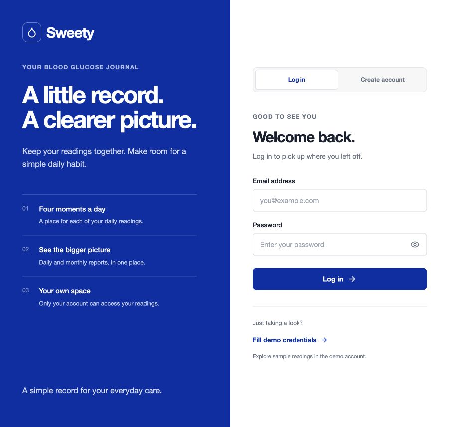
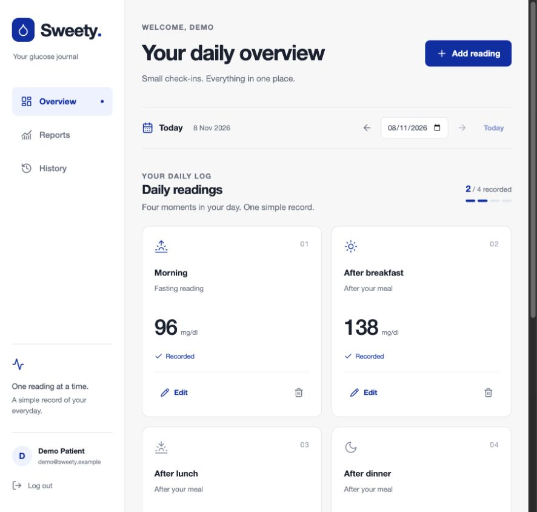
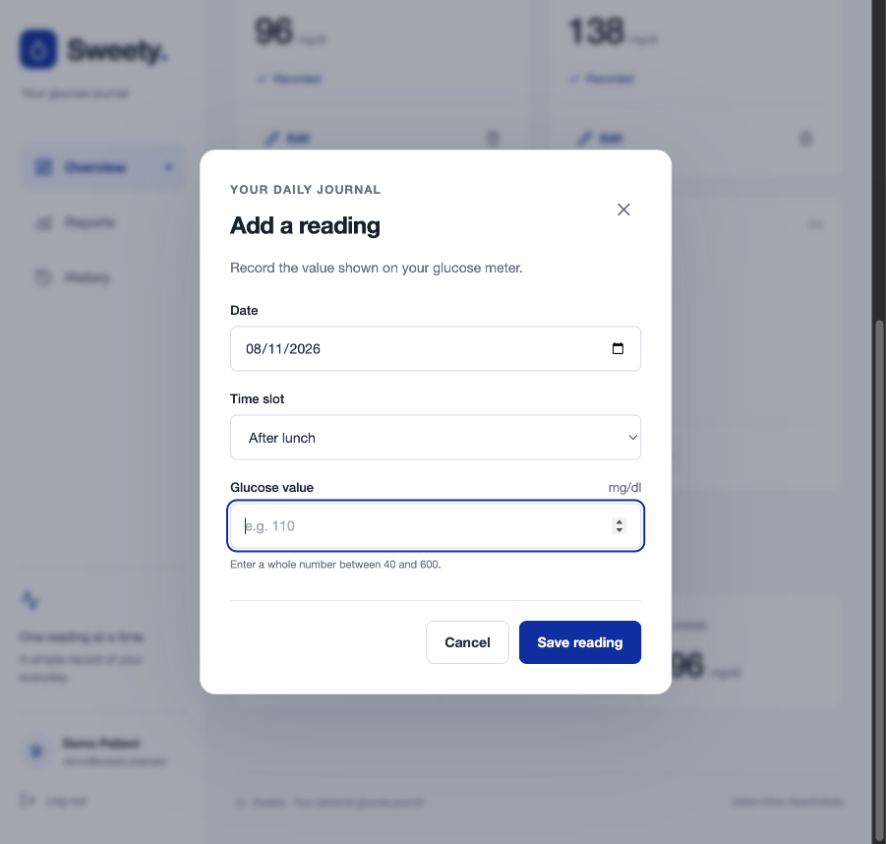
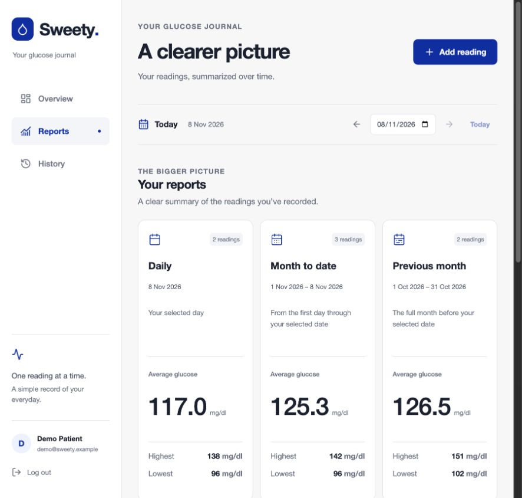
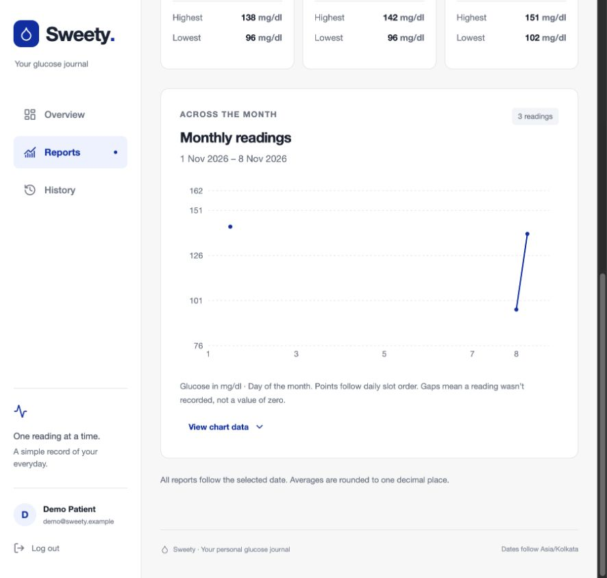
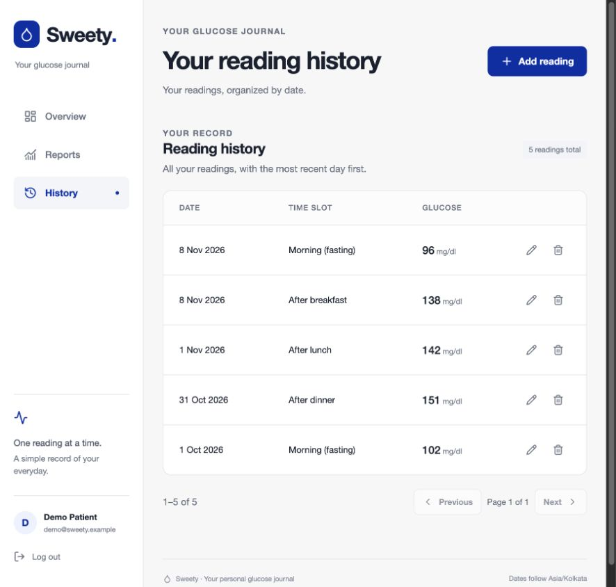
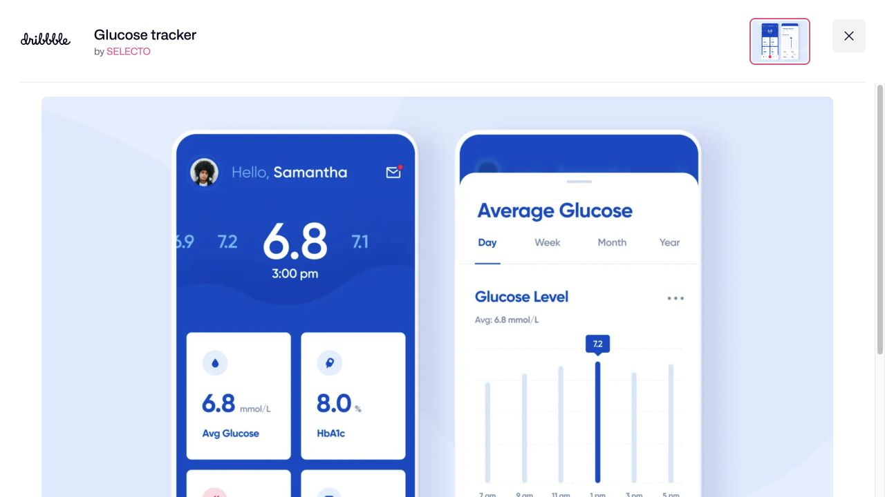
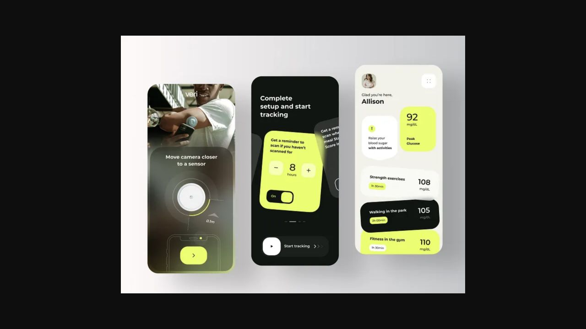
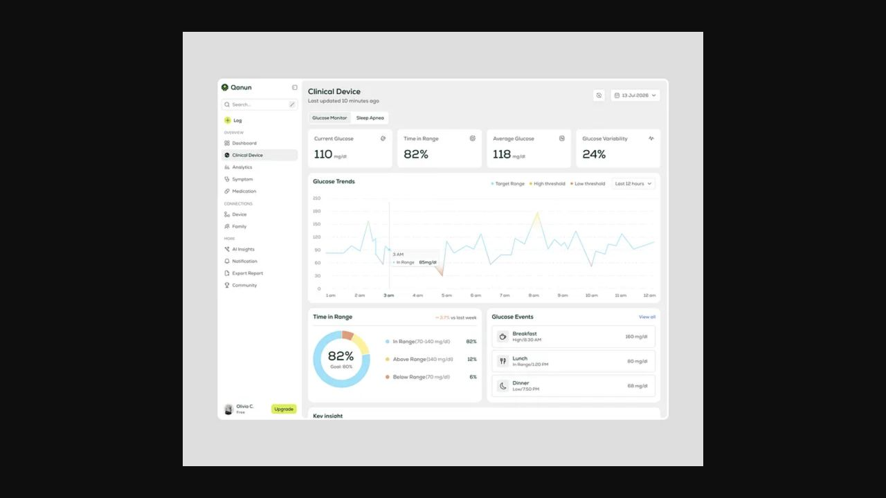

# Sweety UI research and redesign brief

Research date: 8 November 2026. Product Design audit workflow. This is a research and evaluation deliverable, not an implemented redesign.

## Recommendation

Rebuild the visual hierarchy around the daily journal: choose a date, see all four slots, enter a value, and review the record. Use a compact, approachable interface with warm neutral surfaces, dark readable text, one deliberate accent and large numerals. Replace the repeated headings and oversized cards before adding decoration. Keep Overview, Reports and History as the three actual workflows.

This recommendation is design judgment, not a measured patient-usability result. Three visual concepts should be generated and a target selected before implementation.

## Product constraints

Read spec.md, current_work.md, current CSS and DailyView; checked Git status (clean at start). Sweety is React/Express/PostgreSQL, with private account sessions and up to four manually entered glucose readings each day. It is not a live CGM dashboard. Values use mg/dl, dates follow server calendar configuration, reports follow the selected date. Preserve daily / month-to-date / previous-calendar-month semantics, actual chart data, gaps, null empty statistics, validation, ownership and accessible forms. No diagnosis, clinical thresholds, insulin advice, health scores, AI assistant, doctor role, reminders, device pairing or invented measurements.

## Research method and evidence limits

Searched public product documentation, designer portfolios, Dribbble, Behance, X/twitter-domain search results and accessibility design guidance. Opened and visually inspected three shortlisted design references in the in-app browser. Other entries below are document/text-level research, explicitly distinguished from inspected visuals. Search result freshness is not proof of a design's release date. Portfolio performance claims were not independently validated and are not used to predict Sweety outcomes.

Audited the running Docker app at localhost:8080 using its seeded demo account. Fresh screenshots cover login, overview, reading form, reports, chart and history. Observed demo sign-in, navigation, slot-specific form prefill, value autofocus, required-value validation and cancellation. No readings were created, edited or deleted. No registration or destructive workflow was exercised. Screenshot captures were saved and reopened for inspection.

X live search redirected to login. Domain-targeted search returned some profiles but no reliable relevant design-post set. Therefore **no X design post is presented as reviewed**. Public references found elsewhere are not relabeled as X discoveries. Mobile viewport override did not produce a verified mobile capture, so no new mobile acceptance is claimed. No full keyboard, screen-reader, measured contrast, zoom, cross-browser or API regression audit was performed in this pass.

## Current flow evaluation

### 1. Login — healthy foundation; branding opportunity

Clear labels, password visibility and separate demo fill are useful. The solid blue marketing half has more emphasis than the returning-user task. Replace the generic slogan-led composition with a compact brand statement and a restrained preview of the actual journal. Keep the form easy to find. Avoid adding social login or password-reset controls without backend support. Small explanatory text is a readability risk to measure, not a confirmed contrast failure.

### 2. Overview — understandable; hierarchy needs substantial change

Four slots, explicit recorded states, units and 2/4 count are excellent domain structure. At the observed approximately 900px-wide viewport, only the first row of reading cards is fully visible; remaining slots and the summary require scrolling. Large page heading, subtitle, date bar, section heading and another subtitle precede the readings. Repeated empty space inside cards adds more height.

Replace the cards with a single four-row journal or much shorter panels. Put date and completion together. Give unrecorded rows an obvious Add action; keep recorded values prominent and Edit secondary. Collapse the sidebar at an appropriate tablet breakpoint. Keep completion neutral: it describes entries, not health or compliance.

### 3. Reading form — healthy; improve value-first emphasis

The selected After lunch slot and date are prefilled, and value receives focus. An empty save displays the required-value error without submitting a reading. Preserve these behaviors. The visual order gives two fields more space than the one value users usually need to enter. Present date and slot as clear editable context, then a larger numeric field with persistent units and one Save action. On mobile, explore a full-width sheet while preserving native dialog semantics, focus containment and an obvious cancel action. Retain all field errors and pending guards.

### 4. Reports — accurate labels; chart is too far down

Explicit ranges and counts help distinguish the three report windows. However, three tall equal-weight cards and repeated introductory copy consume the first viewport. Make summaries compact and align like-for-like values. Move the monthly chart immediately below a concise report heading/range. Keep a visible label that the chart is month-to-selected-date, whereas the previous-month summary covers a different window. Do not add arbitrary period tabs that change the API contract.

### 5. Chart — honest data; improve sparse-data explanation

The demo shows three points with missing intervals preserved. The explanation that gaps are not zeros and an expandable data table are important strengths. Keep them. Sparse data looks visually unfinished unless the reading count and date context are close to the plot. Increase contextual legibility, show date + slot + value in tooltips and retain the table. Never smooth a continuous curve over unrecorded intervals or add a target-range band merely to resemble a CGM reference.

### 6. History — healthy scan structure; reduce duplication

The date, slot and numeric value columns are clear; edit/delete buttons have descriptive accessible names in the observed tree. The two near-identical history headings add unnecessary height. Use one title, count and compact table. Explore date-grouped rows on narrow screens, preserving exact slot identity and accessible action labels. Do not invent search/filter/export capabilities merely to fill a toolbar. Pagination with many records and destructive confirmation were not retested here.

## Reference shortlist

Scores are qualitative judgments of fit to Sweety, not objective quality ratings.

| Reference | Evidence reviewed | Fit | Useful takeaway | Exclude or adapt |
|---|---|---|---|---|
| [SELECTO — Glucose tracker](https://dribbble.com/shots/6302726-Glucose-tracker) | Browser image inspected | High for hierarchy | Bold primary number, controlled blue, clear separation of daily overview and statistics | HbA1c, mmol/L, extra health metrics and decorative handset presentation |
| [RonDesignLab — Veri CGM Tracker](https://dribbble.com/shots/19126822-Veri-Healthcare-CGM-Tracker) | Browser image inspected | High for a new brand direction | Warm light surfaces, dark ink, distinctive lime accent and short activity rows | Sensor scan, reminders, exercise advice, tilted cards and low-density mockup staging |
| [Imran Hossen — Qanun Glucose Monitor](https://dribbble.com/shots/27732136-Glucose-Monitor-UI-Design) | Browser image inspected | High for report structure | Compact top statistics, wide central chart, small event list | Dense unrelated sidebar, live CGM line, time-in-range, variability and medical recommendations |
| [Ayon Bepary — MyHealth dashboard](https://dribbble.com/shots/26763558-Medical-Health-Care-Dashboard-UI-UX-Design) | Designer's description | Medium | Stated aim of reducing raw-data overload; organized health reporting | Health grades, peer scores, appointments and referrals |
| [Fiber — Diabetes Management](https://www.behance.net/gallery/244280429/Fiber-Diabetes-Management-App-UXUI-Case-Study) | Portfolio description | Medium/high tone reference | Calm everyday-care framing and reduced mental load | Meals and support workflows absent from Sweety; visuals need inspection before borrowing |
| [Glunova — Glucose Track App](https://www.behance.net/gallery/234939097/Glunova-App-Glucose-Track-App-UIUX-Case-Study) | Portfolio metadata | Candidate for next visual pass | Relevant focused mobile case study | No detailed visual judgment claimed from metadata |
| [Diafit — Potential](https://www.behance.net/gallery/225245257/Diafit-AI-Powered-Diabetic-App-UI-UX-Potential) | Portfolio description | Medium visual-research candidate | Glucose-tracking app presentation | AI, meals and personalized clinical insights are outside scope |
| [Glugird](https://www.behance.net/gallery/233701837/Glugird-Case-Study-of-a-Modern-Health-App) | Portfolio description | Medium | Broader daily-record organization reference | Medication, diet and lifestyle modules exceed this project |
| [Cuberto — Health and Fitness Tracker collection](https://dribbble.com/cuberto/projects/851846-Health-and-Fitness-Tracker-UI) | Collection text | Secondary | Historical interaction-reference candidate, including Smart Blood Glucose Meter | Not a verified current production interface; motion not inspected |
| [Oura — app organization](https://support.ouraring.com/hc/lv/articles/360058599753-How-to-Use-the-Oura-App) | Official help text | High for information architecture | Clear separation between today and longitudinal health information | Scores, wearable features and Oura's broader data model |
| [mySugr — getting started](https://www.mysugr.com/support/us/how-get-started-logbook-app) | Official help text | High for task focus | A logbook organized around entering and reviewing records | Extra logging categories, weekly emails and integrations |
| [Gluroo — help](https://app.gluroo.com/help.html) | Official help text | Selective | Structured entry remains available alongside faster entry methods | Chat, natural-language parsing and caregiver groups add unnecessary complexity |
| [NHS — colour](https://service-manual.nhs.uk/design-system/styles/colour) | Official guidance | Essential guardrail | Meaning must also be conveyed through text/icons; measure contrast | Copying NHS branding is unnecessary |
| [GOV.UK — error messages](https://design-system.service.gov.uk/components/error-message/) | Official guidance | Essential guardrail | Specific corrective field messages; distinguish input errors from service failures | Do not replace Sweety's required validation messages casually |

### Visually inspected references

SELECTO — useful numerical hierarchy, but its blue is closer to today's Sweety than a complete identity change.

Veri — strongest departure from the current visual language. Borrow warmth and accent discipline, not the sensor workflow.

Qanun — strongest report-layout reference. Its clinical metrics are not implementable from Sweety's four-slot journal.

## Proposed redesign brief

Audience: a person privately recording meter readings and returning several times a day. Goal: record a value with minimal effort, confirm the correct date/slot, and understand saved history without interpreting it medically. Surface: responsive web application, not a marketing landing page.

Explore three genuinely different layouts in the next visual pass:

1. **Warm daily journal (recommended):** ivory background, dark green/ink typography, restrained lime or sage accent, four compact chronological rows, modest daily summary. Desktop navigation can be narrow; mobile navigation should stay easy to reach.
2. **Clear data workspace:** white/slate surfaces, deep teal or cobalt, compact metrics and a prominent plot on Reports, highly legible history. Most familiar and lowest visual risk, but less distinctive.
3. **Focused daily companion:** compact top navigation, one prominent logging area, four-slot daily sequence and summary beneath. Softer accent and typography; the main value field receives the strongest emphasis.

These are brief directions, not selected mockups or approved implementation targets. Each concept must show real Sweety fields and date semantics. Use the current date 8 November 2026 and clearly synthetic/demo values. No clinical colors on measured values.

### Shared design requirements

- One page title; remove repeated slogans and unnecessary eyebrow labels in daily workflows.
- Body/control typography around 16px; readable secondary text; tabular numerals. Large values should keep units adjacent.
- One primary accent, with separate error and keyboard-focus treatments. Measure every relevant text/control contrast pair; do not judge accessibility by palette appearance alone.
- Comfortable touch targets, visible focus, keyboard-reachable chart data, text labels for statuses and appropriate dialog focus restoration.
- Keep all four daily slots obvious at tablet/mobile sizes without oversized empty placeholders.
- Month-to-date chart stays truthful for empty, single, sparse and complete months; no synthetic continuity.
- Empty/loading/error/full-day states receive the same visual attention as populated mockups.
- No new API, role or operational features needed for the redesign.

## Implementation and acceptance after target selection

Map the selected design onto existing App, AuthScreen, DailyView, ReadingDialog, ReportsView, MonthlyChart, HistoryView and styles.css. Preserve lib.js API behavior and server contracts. Avoid replacing the app with a static prototype.

Verify at 320/390/768/1024/1440 widths, keyboard and zoom. Exercise sign-in/out, slot-prefilled add, invalid value, conflicts, edit/date move, cancel/delete, empty/full-day states, selected-date report windows, sparse charts/data table and history pagination. Run existing helper/RTL tests and production build; run real-PostgreSQL integration tests if contracts change. Compare implemented screenshots against the selected visual target at matching sizes. Record exact outcomes separately from this research.

## X follow-up

The open search required login; no account action was taken. The user has been asked whether to proceed to concepts with verified public references or include their specific X links first. Product Design ideation requires acknowledging an unavailable named source before proceeding without it. UI source files remain unchanged while that choice is pending.

## User-supplied Glow reference follow-up

[Glow Glucose post](https://x.com/glowglucose/status/2037944430250873166) was accessible directly in the in-app browser, although general X search and web fetch were blocked. Inspected inline carousel: compact date strip, small daily reading rows, rounded controls and a trends screen. Image enlargement required login, so fine typography and interactions are not verified. Borrowed date navigation and visual softness while retaining the chosen ivory/forest/citron palette and top-navigation layout. Excluded AI meal scanning, clinical classification and reminders. Revised static target: concept-combined-v2-glow.png.
