# Submission screenshots

Captured from the running full-stack Docker app at `http://localhost:8080` on **9 November 2026 (Asia/Kolkata)**. These are actual UI captures using synthetic seeded accounts, not design mockups.

Desktop viewport requested: **1440 × 1024 CSS pixels**. Mobile viewport requested: **390 × 844 CSS pixels**. Login/signup captures are 1440 × 1024; other desktop captures are scaled by the native browser to 1425 × 1013, and mobile captures to 375 × 812 pixels. Mobile evidence is browser viewport testing, not a physical-device test. Some captures show a scrolled section.

The demo was seeded again on 9 November; today has 96 and 138 mg/dl (average 117.0), with existing historical samples retained. Dates and totals can change when reseeded on a later day. Screenshots satisfy the assignment’s screenshot-or-video requirement.

[Submission guide](../../../SUBMISSION.md) · [Project README](../../../README.md)

## Login and demo autofill

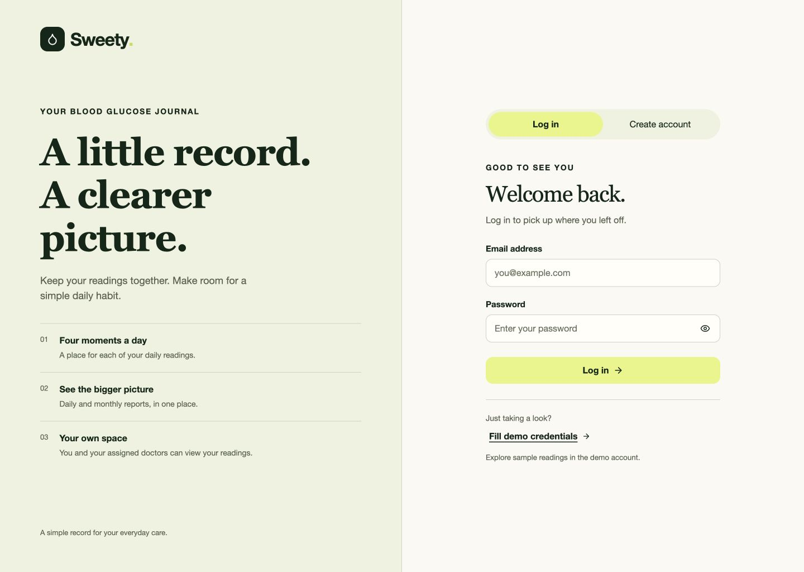

## Patient registration

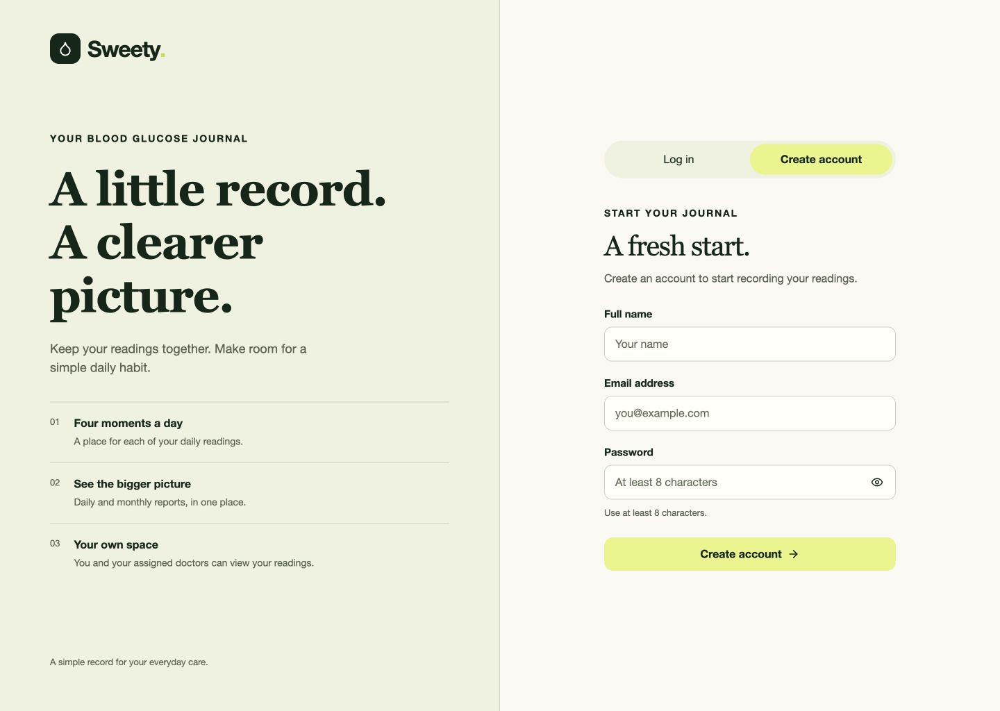

## Daily overview and four-slot entry

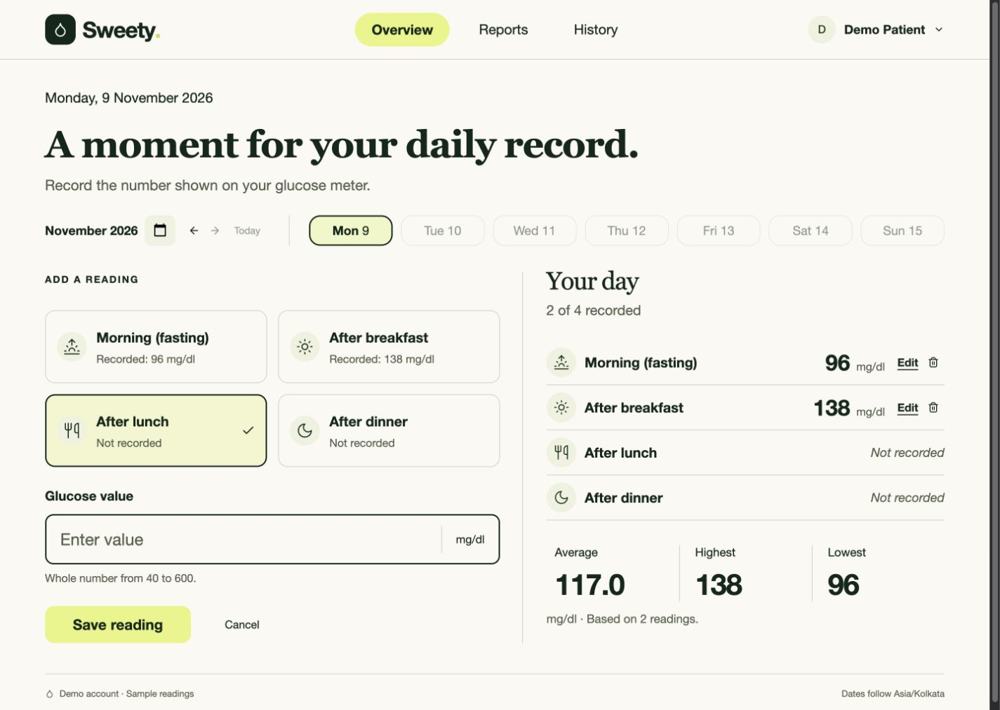

## Required glucose validation

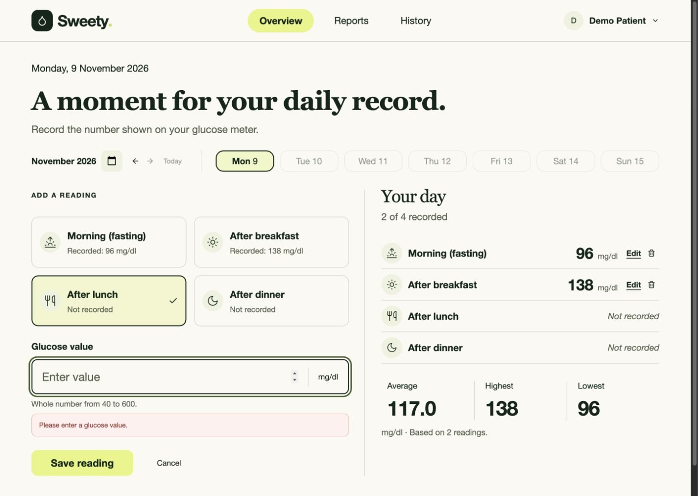

## Edit reading dialog

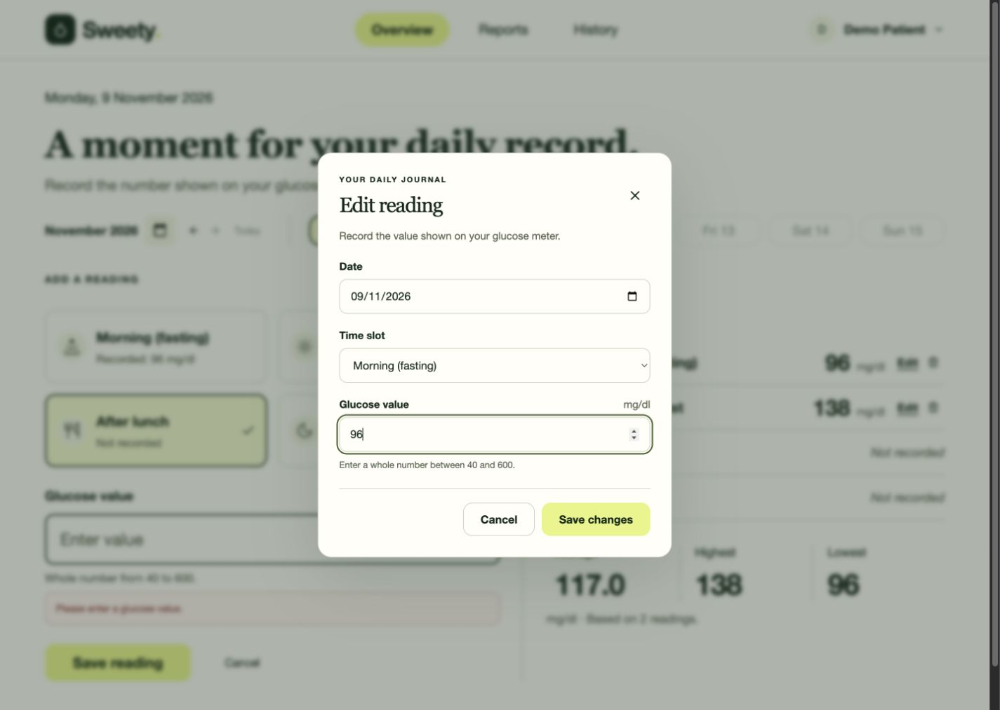

## Daily, month-to-date and previous-month reports

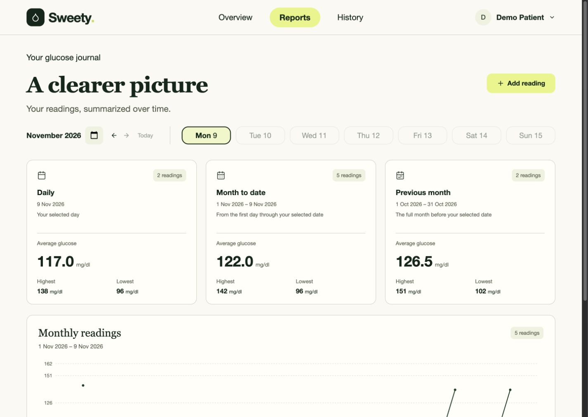

## Monthly chart and exact-value data table

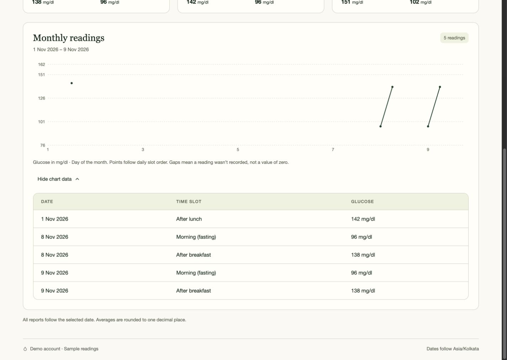

## Assigned-patient doctor workspace

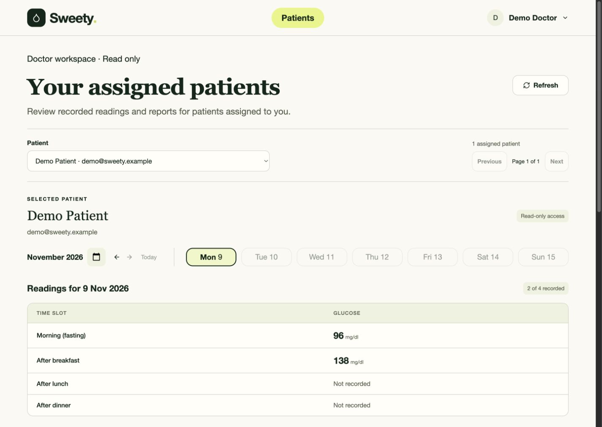

## Reading history and actions

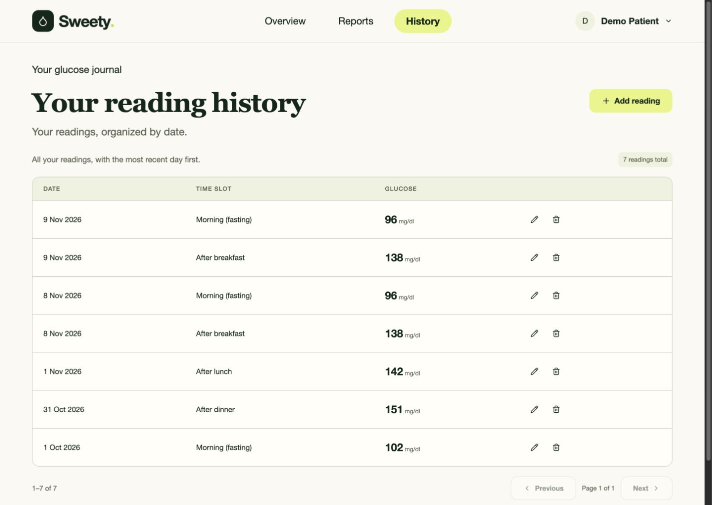

## Doctor workspace on a narrow screen

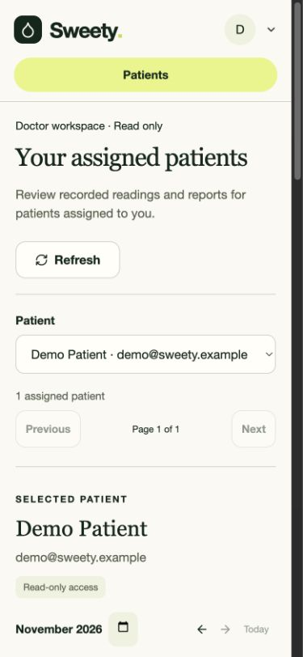

## Mobile overview and reading entry

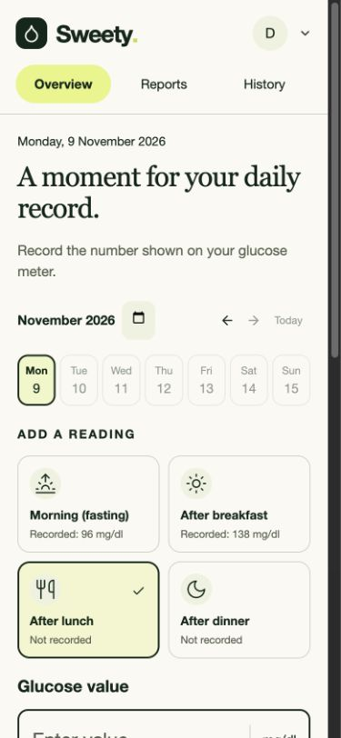

## Mobile daily readings and statistics

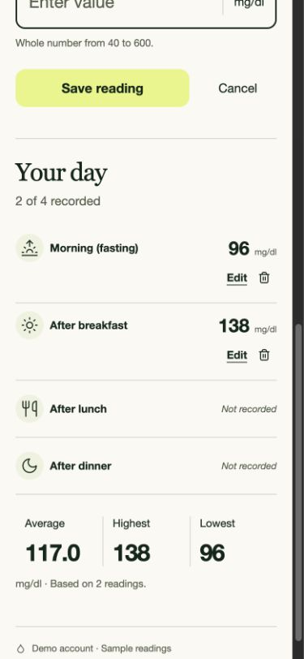

## Mobile reading history

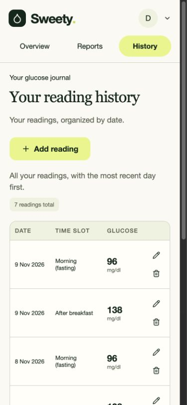

